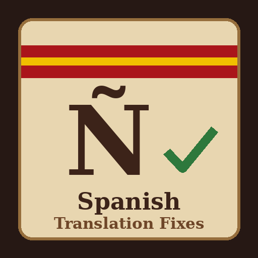

# Spanish Translation Fixes

A Crusader Kings III mod that fixes broken and mistranslated texts in the official Spanish localization, so you can play in Spanish without code, brackets or nonsense showing up in events and tooltips.

- **Game version:** 1.20.x
- **Mod version:** 0.9.4 (beta)
- **Author:** [Sourenics](https://github.com/Sourenics)
- **Steam Workshop:** [Spanish Translation Fixes](https://steamcommunity.com/sharedfiles/filedetails/?id=3817707585)

## Beta

This is a **public beta**. Every fix has been checked against the game files and the mod has been loaded in a test game, but the fixed texts have not all been seen in game yet. If you find a text that looks wrong, broken or untranslated, with or without this mod, please [report it](#reporting-a-wrong-text): every report helps reach a stable 1.0.0.

## What it fixes

Version 0.9.4 replaces **8,273 strings**. Every change is explained in [FIXED_STRINGS.md](FIXED_STRINGS.md).

### Names of untitled characters (7,948)

The Spanish text writes a character's title and name in lowercase so that the title reads naturally mid-sentence ("la condesa Bertha"). When the character has no title, the name itself came out in lowercase, with the article kept: "la bertha", "de la bertha". The mod adds custom localization entries that lowercase the title only when there is one and drop the article otherwise, so untitled characters now read "Bertha", "de Bertha", "a Bertha".

### Broken strings (332)

Texts where the game shows raw code, an empty space or the wrong character, because the Spanish file contains a technical mistake:

- **Misspelled data functions**, such as `Custon` instead of `Custom`, `GerHerHim` instead of `GetHerHim`, `Select_Cstring` instead of `Select_CString`, or `GetShortUINameU` instead of `GetShortUIName|U` (43 relationship descriptions).
- **Characters that do not exist in the event.** Many Spanish strings were copied from other events and refer to someone who is not there (`hated_participant` instead of `murder_target`, `farmer` instead of `farmer_char`, `deceased_pal` instead of `dead_relation`…). In game, the name or the gender agreement goes missing.
- **Gender agreement codes that do not exist in the game**, such as `ES_ElLA` (instead of `ES_ElLa`), `ES_SheHe` or `FighterTermPlural`. They are replaced with the correct ones.
- **A formatter translated by mistake**: `english_rita_i_suffix` instead of `english_rite_i_suffix`, which broke 27 war-god rite names.
- **Format codes and line breaks**, such as `#EMPyour guerra` or texts glued to the previous paragraph.
- **Leftover English** inside Spanish sentences ("fundó el the Pandidakterion").
- **"Mi mi hermana"**: the template that introduces characters in many events added a second "mi".
- **Wrong keys and arguments** passed to functions: an item slot translated as `'casco'` instead of `'helmet'`, cooldowns read from another decision's timer, the wrong tenet in the evangelize tooltip, faith instead of rite for tenet names, the piety level of the wrong character, misspelled region and agent keys…
- **Names shown as broken links.** In 94 strings, plain names (mostly rites, but also weapons, accolades and blocs) were formatted as links to game concepts, which they are not, so they appeared as a faded, broken link.

### Spelling and grammar (68)

Typos and missing accents found in the text: "haciaa", "basatnte", "probabildad", "Sin embaro", "acutal", "es mas probable", "el publico ruge"…

### How the fixes were found

The Spanish file was compared, string by string, with the English one and with the other official translations:

1. Every data function and scope used in Spanish was checked against the ones the game uses in any language. Unknown names are typos.
2. Every character referenced by a Spanish string was checked against the English string with the same key and the event it belongs to.
3. Every gender agreement code (`Custom('ES_…')`) was checked against the definitions in the game files.
4. Format codes, variables, icons and line breaks were compared with the English text.
5. The arguments passed to every function (item slots, timers, regions, tenets…) were compared with the English text.
6. A spell check of the whole Spanish text, with every candidate reviewed by hand.

Every corrected string only uses functions and characters that the official translations of that same string also use.

### What it does not change

- Texts that read differently from English on purpose. Translations are not literal, and the translators often reorganize sentences.
- Proper names, Latin quotes and DLC names, which the game leaves in their original form.
- Texts written with a slash, such as nicknames like `el/la Calvo`. They are left as they are for now.

## Installation

### Steam Workshop

Subscribe on the Steam Workshop page and enable the mod in the Paradox launcher.

### Manual

1. Download this repository (green **Code** button → **Download ZIP**).
2. Copy the contents of the `mod/` folder (`spanish_translation_fixes/` and `spanish_translation_fixes.mod`) into:
   - **Windows:** `Documents/Paradox Interactive/Crusader Kings III/mod/`
   - **Linux:** `~/.local/share/Paradox Interactive/Crusader Kings III/mod/`
   - **macOS:** `~/Documents/Paradox Interactive/Crusader Kings III/mod/`
3. Enable **Spanish Translation Fixes (Beta)** in the Paradox launcher.

## Compatibility

- Only changes localization: no game rules, events or scripts are modified. Besides the replaced strings, it adds its own custom localization entries (`common/customizable_localization/stf_titled_name_custom_loc.txt`); no vanilla file is overwritten.
- Only affects players with the game in Spanish.
- No DLC required. Strings from DLCs you do not own are simply never shown.
- Can be added to or removed from an existing save.
- Each string is replaced individually (`localization/replace/spanish/`), so it works alongside other mods. If another mod also replaces one of these strings, the one loaded first wins.
- When a game update changes one of these strings, this mod keeps showing its own version until it is updated. If you notice an outdated text after a patch, please report it.

## Reporting a wrong text

Please open an [issue](../../issues/new/choose) using the **Translation error** template, or post on the Steam Workshop page. The most useful information is:

1. **The text as it appears in the game**, or the part that is wrong.
2. **Where it appears**: event title, decision, tooltip, window…
3. **A screenshot.**
4. Optionally, **how it should read**.
5. **The game version** (shown in the main menu, for example 1.20.1) and **the mod version**.

Suggestions of mistranslations are especially welcome: they are hard to find automatically.

## License

**Spanish Translation Fixes** © 2026 Sourenics, licensed under [Creative Commons Attribution-ShareAlike 4.0 International (CC BY-SA 4.0)](https://creativecommons.org/licenses/by-sa/4.0/).

Forks, extensions and alternative versions are welcome, provided that you:

- **Credit the original author** (Sourenics) and link to this repository.
- **Indicate the changes** you made.
- **Release your version under the same license** (CC BY-SA 4.0).

### Paradox Interactive content

Crusader Kings III and its content are © Paradox Interactive AB and are **not** covered by this license. The corrected strings are modified copies of the official Spanish localization. This project is an unofficial fan-made mod, not affiliated with or endorsed by Paradox Interactive. Like every CK3 mod, it must be distributed free of charge.
